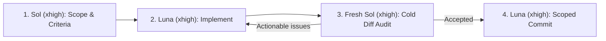

**Languages:** **English** | [Русский](i18n/README.ru.md)

# Agent Skills

**Stop letting one AI model grade its own homework.**

Practical multi-model skills and CLI bridges for **Codex**, **Claude Code**, and **Antigravity**—built so fast coding agents get independent frontier reasoning, adversarial diff audits, and clean Git discipline without manual copy-paste.

---

## Why This Exists

Using a single AI coding agent in a single context window hits two predictable walls:

1. **The Human Clipboard Tax:** Your daily-driver agent gets stuck in a loop on a subtle race condition, state-machine invariant, or architecture trade-off. Getting a second opinion means manually copying files into another app, waiting, and pasting answers back.
2. **Self-Review Blindness:** When the exact same model instance plans a feature, writes the code, and "reviews" its own diff, confirmation bias wins. Shortcuts get rationalized, edge cases slip through, and multi-part tasks turn into tangled commits.

This repository solves both problems with two focused skills:

| Skill | Works With | Solves | Core Mechanism |
| :--- | :--- | :--- | :--- |
| **[Ask Codex](skills/ask-codex/README.md)** | Claude Code, Antigravity, Codex, Terminal | Getting an independent second opinion without leaving your editor or risking unwanted edits | Headless **read-only** bridge to Codex CLI + fuzzy model switcher + codebase-grounded verification |
| **[Codex Development Orchestrator](skills/codex-dev-orchestrator/README.md)** | Codex | Single-model blind spots, sloppy commits, and context collisions on multi-step engineering | Adversarial **Sol → Luna → Fresh Sol** loop, Git safety checks, worktree isolation, and dependency waves |

---

## The Skills

### 1. [Ask Codex](skills/ask-codex/README.md) — Cross-Agent Second Opinion & Model Switcher

Give Claude Code, Antigravity, or your shell a direct, non-interactive line to OpenAI's deepest reasoning models via Codex CLI—without ever letting the consulted model touch your files.


- **Zero copy-paste:** Ask your agent *"Get a second opinion from Codex on this retry state machine"*—it packages the right context, calls `ask-codex` behind the scenes, and stress-tests the answer against your actual codebase before proposing edits.
- **Strictly read-only & stateless:** Runs Codex in ephemeral `read-only` sandbox mode (`codex exec --ephemeral -s read-only`), leaving your working tree untouched and `stdout` clean for agent consumption.
- **Fuzzy model switching without rewriting prompts:** List cached models (`ask-codex --models`), set your default partner (`ask-codex --set terra`), or escalate one brutal proof (`ask-codex -m sol "..."`) without editing skill files when new models ship.
- **macOS `ChatGPT.app` aware:** Automatically detects the native Codex binary bundled inside `/Applications/ChatGPT.app` on macOS before falling back to `codex` in `PATH`.

**[Read the Ask Codex guide →](skills/ask-codex/README.md)** ([На русском](skills/ask-codex/i18n/README.ru.md))

---

### 2. [Codex Development Orchestrator](skills/codex-dev-orchestrator/README.md) — Adversarial Sol → Luna → Sol Loop

Turn Codex from a solo coder into a disciplined engineering loop where **the model instance that writes the code never signs off on its own diff**.



- **Separation of powers:** `GPT-6.1 Sol` (`xhigh`) inspects the repo and writes explicit acceptance criteria without editing files. `GPT-6 Luna` (`xhigh`) implements without committing. A **brand-new `Sol` (`xhigh`) instance**—with zero sunk-cost bias—audits the diff cold until every criterion holds. Only then does `Luna` commit.
- **Zero-ceremony fast path:** Pure presentation edits (typos, copy, formatting, `display_name`/`short_description` tweaks that leave behavior and interfaces unchanged) bypass orchestration automatically.
- **Git-first safety & plain-English isolation:** Verifies Git tracking before any edit, preserves unrelated uncommitted changes, and uses Git worktrees when parallel tasks risk colliding—explaining isolation in plain language.
- **Multi-task dependency waves:** For multi-part work, Sol decomposes tasks into dependency waves and—when separate task chats are authorized—runs each task in its own clean project dialogue.

**[Read the Orchestrator guide →](skills/codex-dev-orchestrator/README.md)** ([На русском](skills/codex-dev-orchestrator/i18n/README.ru.md))

---

## 30-Second Installation

```bash
git clone https://github.com/dmatora/agent-skills.git ~/Developer/agent-skills
cd ~/Developer/agent-skills
./install.sh
```

What `./install.sh` sets up (non-destructively):

- Symlinks every skill in `skills/` into **Codex** (`${CODEX_HOME:-~/.codex}/skills/`).
- Symlinks **Ask Codex** into **Antigravity** (`~/.gemini/config/skills/`) and **Claude Code** (`~/.claude/skills/`).
- Symlinks CLI helpers from `skills/*/bin/` (`ask-codex`) into `~/.local/bin/`.
- **Never overwrites existing files or custom configs**—existing paths are left untouched and reported.

> **Prerequisites:** Make sure `~/.local/bin` is in your `PATH`, and install + authenticate Codex CLI if you use `ask-codex`. Pull updates anytime with `git pull`—everything is symlinked.

---

## Quick Start

### In Claude Code or Antigravity

Just ask naturally in chat:

> *"Before we refactor `SettlementEngine`, ask Codex to check our rounding invariants and top 3 edge cases."*

### From Your Terminal

```bash
# 1. See models available in your local Codex cache
ask-codex --models

# 2. Pick a default partner model (full slug or unique substring)
ask-codex --set gpt-6.1-terra
ask-codex --current

# 3. Run a read-only architectural review from any project folder
ask-codex "Review this project and point out the three highest-risk issues. Do not change files."

# 4. Escalate a single hard problem to Sol without changing your saved default
ask-codex -m gpt-6.1-sol "Check this lock-free queue for ABA or memory-ordering bugs."
```

*(Model names above are examples—pick any available model from `ask-codex --models`.)*

---

## Design Principles

- **Adversarial verification over self-approval.** Whether crossing agent boundaries (`ask-codex`) or separating Architect, Builder, and Auditor roles (`codex-dev-orchestrator`), a second set of eyes checks assumptions against real code.
- **Read-only advice, Git-guarded mutations.** Consultations never modify files; orchestrated implementations require Git tracking and commit only after explicit audit sign-off.
- **Rich docs for humans, surgical prompts for agents.** Tutorials and architecture notes live in `README.md`. Every `SKILL.md` stays compact (~15–20 lines) so your agent spends its context window on your codebase, not prompt bloat.
