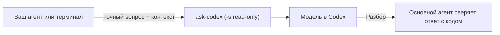
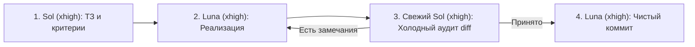

**Языки:** [English](../README.md) | **Русский**

# Agent Skills

**Хватит позволять одной ИИ-модели самой у себя принимать код.**

Прикладные мультимодельные навыки и CLI-мосты для **Codex**, **Claude Code** и **Antigravity**: подключайте независимый взгляд старших рассуждающих моделей, жёсткое разделение ролей при разработке и аккуратную работу с Git — без ручного копипаста между окнами.

---

## Зачем это нужно

Когда один ИИ-агент в одиночку ведёт задачу внутри одного контекстного окна, разработка быстро упирается в две классические проблемы:

1. **Налог на «живой буфер обмена»:** ваш основной агент зацикливается на тонкой гонке данных, инварианте стейт-машины или развилке в архитектуре. Чтобы получить второе мнение, приходится руками таскать куски кода в другое окно и обратно.
2. **Слепота при самопроверке:** когда один и тот же инстанс модели сам планирует задачу, сам пишет код и сам «ревьюит» свой diff, срабатывает предвзятость подтверждения. Срезанные углы легко оправдываются, краевые случаи ускользают, а несколько задач сваливаются в один грязный коммит.

В этом репозитории лежат два сфокусированных инструмента, которые закрывают оба сценария:

| Навык | Где работает | Какую боль решает | Как устроен |
| :--- | :--- | :--- | :--- |
| **[Ask Codex](../skills/ask-codex/i18n/README.ru.md)** | Claude Code, Antigravity, Codex, терминал | Второе мнение от глубокой модели без выхода из IDE и без риска нежелательных правок | Неинтерактивный **read-only** мост к Codex CLI + быстрый переключатель моделей + сверка гипотез с реальным кодом |
| **[Оркестратор разработки Codex](../skills/codex-dev-orchestrator/i18n/README.ru.md)** | Codex | Слепые зоны одиночной модели, каша в коммитах и конфликты при многошаговой разработке | Цикл **Sol → Luna → свежий Sol**, контроль Git и worktree-изоляции, декомпозиция на волны зависимостей |

---

## Навыки в репозитории

### 1. [Ask Codex](../skills/ask-codex/i18n/README.ru.md) — Независимое второе мнение и переключатель моделей

Прямой неинтерактивный канал из Claude Code, Antigravity или обычного терминала к глубоким рассуждающим моделям OpenAI через Codex CLI — в строгом режиме чтения.



- **Никакого копипаста между окнами:** напишите агенту *«Спроси мнение Codex по инвариантам этого ретрай-автомата, прежде чем править код»* — агент сам соберёт нужный контекст, вызовет `ask-codex` и критически проверит ответ на реальном коде проекта.
- **Строгий `read-only` без мусора в сессиях:** запрос идёт через `codex exec --ephemeral -s read-only` — Codex может читать проект, но гарантированно не меняет файлы и отдаёт чистый ответ в `stdout`.
- **Переключение моделей одной командой:** смотрите доступные модели (`ask-codex --models`), меняйте рабочую модель по подстроке (`ask-codex --set terra`) или разово вызывайте тяжёлую артиллерию (`ask-codex -m sol "..."`) без переписывания промптов и скиллов.
- **Поддержка нативного бинарника из `ChatGPT.app` на macOS:** утилита сначала проверяет встроенный Codex внутри `/Applications/ChatGPT.app`, а если его нет — ищет `codex` в `PATH`.

**[Подробное руководство по Ask Codex →](../skills/ask-codex/i18n/README.ru.md)** ([English](../skills/ask-codex/README.md))

---

### 2. [Оркестратор разработки Codex](../skills/codex-dev-orchestrator/i18n/README.ru.md) — Разделение властей по циклу Sol → Luna → Sol

Превращает Codex из одиночного кодера в дисциплинированный конвейер разработки, где **инстанс модели, написавший код, никогда сам его не принимает**.



- **Архитектор → Разработчик → Независимый аудитор:** `GPT-6.1 Sol` (`xhigh`) изучает проект и фиксирует объём работ и критерии приёмки без правок файлов. `GPT-6 Luna` (`xhigh`) пишет код без коммита. Затем **новый, чистый инстанс `Sol` (`xhigh`)** — без привязанности к уже написанному решению — проверяет diff по критериям и гоняет итерации до полной приёмки. Только после этого `Luna` делает аккуратный коммит.
- **Мгновенный обход для косметических правок:** опечатки, тексты, форматирование и чисто презентационные поля (вроде `display_name`/`short_description`), не меняющие поведение и интерфейсы, выполняются напрямую без тяжёлого цикла.
- **Безопасность Git и изоляция без лишней терминологии:** проверяет наличие Git до начала работ, бережёт чужие незакоммиченные изменения и автоматически задействует Git worktree там, где параллельные правки могут столкнуться, объясняя изоляцию простыми словами.
- **Волны задач для крупных фич:** если запрос состоит из нескольких задач, Sol разбивает его на атомарные этапы с зависимостями и — при вашем разрешении на отдельные task-чаты — разводит их по изолированным диалогам проекта.

**[Подробное руководство по Оркестратору →](../skills/codex-dev-orchestrator/i18n/README.ru.md)** ([English](../skills/codex-dev-orchestrator/README.md))

---

## Установка за 30 секунд

```bash
git clone https://github.com/dmatora/agent-skills.git ~/Developer/agent-skills
cd ~/Developer/agent-skills
./install.sh
```

Что аккуратно настраивает `./install.sh`:

- Подключает симлинками все навыки из `skills/` в **Codex** (`${CODEX_HOME:-~/.codex}/skills/`).
- Подключает **Ask Codex** в **Antigravity** (`~/.gemini/config/skills/`) и **Claude Code** (`~/.claude/skills/`).
- Выносит исполняемые утилиты из `skills/*/bin/` (`ask-codex`) в `~/.local/bin/`.
- **Ничего не затирает:** существующие файлы, конфиги и чужие симлинки остаются нетронутыми (скрипт просто сообщит о пропуске).

> **Перед стартом:** убедитесь, что `~/.local/bin` добавлен в `PATH`, а для работы `ask-codex` установлен и авторизован Codex CLI. Обновление репозитория — обычный `git pull`, все ссылки подхватятся сразу.

---

## Быстрый старт

### В чате с Claude Code или Antigravity

Просто попросите агента человеческим языком:

> *«Прежде чем трогать `SettlementEngine`, спроси второе мнение у Codex: нет ли дыр в инвариантах округления и какие три риска тут главные.»*

### Напрямую из терминала

```bash
# 1. Посмотреть список моделей в локальном кэше Codex
ask-codex --models

# 2. Выбрать модель по умолчанию (по полному имени или уникальной подстроке)
ask-codex --set gpt-6.1-terra
ask-codex --current

# 3. Запустить безопасное read-only ревью из папки любого проекта
ask-codex "Посмотри этот проект и назови три самые опасные архитектурные проблемы. Файлы не изменяй."

# 4. Разово позвать Sol на сложную задачу, не меняя сохранённую модель
ask-codex -m gpt-6.1-sol "Проверь эту lock-free очередь на ABA-проблему и гонки памяти."
```

*(Имена моделей приведены для примера — укажите любую доступную в вашем аккаунте модель из вывода `ask-codex --models`.)*

---

## Инженерные принципы

- **Независимая проверка вместо самооценки.** И при кросс-агентной консультации (`ask-codex`), и внутри конвейера `Sol → Luna → свежий Sol` гипотезы проверяются на реальном коде вторыми глазами.
- **Советы — в `read-only`, изменения — под защитой Git.** Консультации физически не могут тронуть рабочее дерево, а оркестратор не правит код вне Git и коммитит только после явной приёмки аудитором.
- **Богатая документация для людей, хирургические промпты для агентов.** Подробные объяснения и примеры живут в `README.md`, а сами файлы `SKILL.md` занимают ~15–20 строк, чтобы не сжигать контекстное окно агента на маркетинговую воду.
