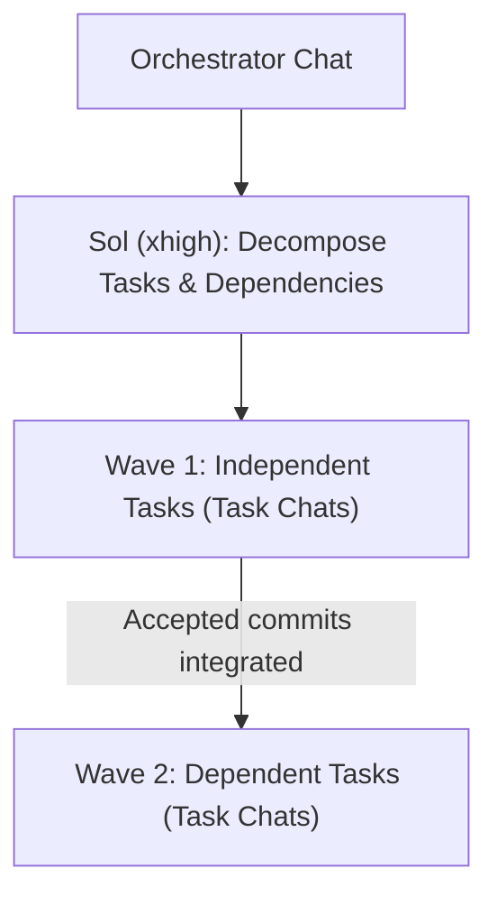

**Languages:** **English** | [Русский](i18n/README.ru.md)

# Codex Development Orchestrator

**Turn Codex from a solo coder that grades its own homework into an adversarial Architect → Builder → Auditor workflow.**

---

## Why Solo-Model Coding Breaks Down on Real Tasks

When a single AI model instance plans a change, writes the code, reviews its own diff, and commits inside one long conversation, three failure modes show up fast:

1. **Confirmation bias in self-review:** The model that just spent 2,000 tokens inventing a shortcut is the worst possible reviewer of that shortcut.
2. **Tangled multi-part diffs:** Ask for three related changes and you get one sprawling commit where unfinished refactors, edge-case bugs, and unrelated working-tree edits blur together.
3. **Silent Git hazards:** Parallel tasks overwrite each other's files, or uncommitted local work gets swept into a commit by mistake.

**Codex Development Orchestrator** fixes this by splitting planning, implementation, and review across specialized models and fresh instances—while keeping trivial copy/formatting edits instant.

---

## How It Works

### Single Task: The `Sol → Luna → Fresh Sol` Loop

Your main Codex chat acts as the orchestrator (running whatever model you selected) and drives a strict four-stage loop:


1. **Scope & Acceptance Criteria (`GPT-6.1 Sol xhigh`):** Inspects project instructions and relevant code, then defines crisp scope and acceptance criteria. **Strictly read-only—Sol never edits files.**
2. **Implementation (`GPT-6 Luna xhigh`):** Implements the brief in the working tree **without committing**.
3. **Cold Diff Audit (Fresh `GPT-6.1 Sol xhigh`):** A **brand-new** Sol instance—with zero attachment to how the code was written—audits the diff against the acceptance criteria. Any actionable issues go back to Luna, followed by another fresh Sol audit until Sol explicitly signs off. Unresolved product choices or blockers are surfaced directly to you.
4. **Clean Local Commit (`GPT-6 Luna xhigh`):** Only after explicit acceptance does Luna commit strictly that task's changes following repository conventions—never pushing automatically and never sweeping in unrelated files.

---

### Multi-Task Work: Dependency Waves & Isolated Threads

When a request contains more than one coherent task, the current chat stays clean as the coordinator:



- **Wave scheduling:** Sol breaks the work into atomic tasks with explicit acceptance criteria and dependencies. Independent tasks with stable contracts can run in parallel waves; tasks with unsettled architecture or tight dependencies run sequentially so downstream work builds on accepted commits.
- **Scoped task chats (with explicit permission):** When your prompt or standing instructions explicitly authorize separate task chats, the orchestrator creates one dedicated project dialogue per task—keeping each child prompt laser-focused on its own goal, owned paths, and `Sol → Luna → Fresh Sol` loop.
- **Plain-English Git worktree isolation:** Works in your current checkout by default when safe, and automatically spins up or reuses Git worktrees when parallel edits or dirty working trees create collision risks—explaining isolation in plain language without requiring you to manage `git worktree` commands yourself.

---

## Built-In Guardrails

| Scenario | What the Orchestrator Does |
| :--- | :--- |
| **Pure presentation tweak** (typo, copy, formatting, `display_name` / `short_description` with zero behavioral impact) | **Fast-path bypass:** applies the edit directly without spinning up the Sol/Luna loop. |
| **Consultation or review-only prompt** | **Skips orchestration:** lets Codex answer or review directly without unnecessary workflow ceremony. |
| **Folder is not a Git repository** | **Hard stop before edits:** pauses and asks whether to initialize Git or switch folders—never edits unversioned code or runs `git init` behind your back. |
| **Dirty working tree with unrelated edits** | **Preserves unowned work:** inspects `git status` and diffs, isolates or sequences safely, and ensures each commit stages only its own task's files. |
| **Missing model, unauthorized task chats, or unverified child-chat model** | **Transparent blocker:** reports the exact constraint instead of silently downgrading models, overriding user model settings, or cramming multiple tasks into one chat. |
| **Pre-existing or unrelated Codex chats** | **Strict thread isolation:** never messages outside threads unless you explicitly authorize that exact recipient and purpose. |

---

## Installation & Requirements

Install from the [repository root](../../README.md):

```bash
./install.sh
```

This symlinks `codex-dev-orchestrator` into `${CODEX_HOME:-~/.codex}/skills/codex-dev-orchestrator`.

- **Environment:** Designed for **Codex** setups with access to `GPT-6.1 Sol` (`xhigh`) and `GPT-6 Luna` (`xhigh`).
- **Multi-task threads:** Separate per-task project dialogues require Codex project/thread tools and explicit authorization in your prompt or standing instructions (plus `Luna xhigh` selected or verified as default for child task chats). Single-task orchestration works right inside your current dialogue.

---

## Canonical Agent Specifications

To keep context-window token usage minimal during execution, the machine-facing instructions are kept compact and separate from this guide:

- [`SKILL.md`](SKILL.md) — Activation boundaries, bypass rules, and core routing ([Russian reference translation](i18n/SKILL.ru.md)).
- [`references/workflow.md`](references/workflow.md) — Detailed rules for Git worktrees, dependency waves, and thread isolation ([Russian reference translation](i18n/workflow.ru.md)).
