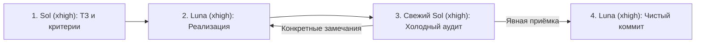
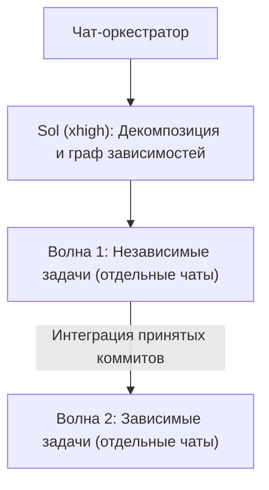

**Языки:** [English](../README.md) | **Русский**

# Оркестратор разработки Codex (`codex-dev-orchestrator`)

**Превращает Codex из одиночного кодера, который сам у себя принимает домашнюю работу, в инженерный конвейер «Архитектор → Разработчик → Независимый аудитор».**

---

## Почему одиночный цикл ломается на реальных задачах

Когда один и тот же инстанс модели в одном длинном диалоге сам планирует задачу, сам пишет код, сам смотрит свой diff и сам коммитит, быстро вылезают три системные болезни:

1. **Предвзятость при самопроверке:** модель, которая пять шагов назад сама придумала обходной костыль, хуже всех подходит на роль ревьюера этого костыля.
2. **Свалка в многосоставных задачах:** просите сделать три связанные доработки — получаете один раздутый коммит, где перемешаны недоделанный рефакторинг, пропущенные краевые случаи и случайные правки по соседству.
3. **Тихие грабли с Git:** параллельные задачи затирают файлы друг друга, а ваши незакоммиченные локальные наработки случайно попадают в чужой коммит.

**Оркестратор разработки Codex** решает это разделением ролей между специализированными моделями и чистыми инстансами — и при этом не тормозит на мелких текстовых правках.

---

## Как устроен процесс

### Одна задача: цикл `Sol → Luna → свежий Sol`

Ваш основной чат остаётся координатором (на той модели, которую выбрали вы сами) и проводит задачу через четыре чётких этапа:



1. **Объём и критерии приёмки (`GPT-6.1 Sol xhigh`):** изучает правила проекта и релевантный код, после чего формулирует рамки задачи и чёткие критерии приёмки. **Строго без редактирования файлов.**
2. **Реализация (`GPT-6 Luna xhigh`):** воплощает ТЗ в коде **без коммита**.
3. **Холодный аудит diff (новый инстанс `GPT-6.1 Sol xhigh`):** **свежий** агент Sol — без «эффекта вложенных усилий» и привязанности к написанному коду — проверяет diff строго по критериям приёмки. Все рабочие замечания возвращаются Luna, после чего запускается новый чистый аудит Sol — и так до явной приёмки. Продуктовые развилки и блокеры сразу выносятся вам.
4. **Аккуратный локальный коммит (`GPT-6 Luna xhigh`):** только после приёмки Sol агент Luna создаёт коммит ровно с изменениями этой задачи по правилам репозитория — без автоматического `git push` и без захвата посторонних файлов.

---

### Несколько задач: волны зависимостей и изолированные чаты

Если в запросе больше одной самостоятельной задачи, текущий чат остаётся чистым пультом управления:



- **Планирование волнами:** Sol делит работу на атомарные задачи с критериями приёмки и зависимостями. Задачи со стабильными контрактами и разными путями идут параллельной волной; задачи с подвижной архитектурой или прямыми зависимостями выстраиваются последовательно поверх уже принятых коммитов.
- **Отдельные чаты под задачи (только с вашего разрешения):** если ваш запрос или постоянные инструкции явно разрешают отдельные task-чаты, оркестратор создаёт чистый проектный диалог под каждую задачу — передавая туда только её цель, зону ответственности и цикл `Sol → Luna → свежий Sol`.
- **Изоляция через Git worktree без лишней терминологии:** по умолчанию работа идёт в текущей копии, но если есть риск пересечения параллельных правок или помех от грязного дерева, оркестратор создаёт или переиспользует Git worktree — объясняя изоляцию простыми словами, без необходимости вручную командовать `git worktree`.

---

## Встроенные предохранители

| Ситуация | Как ведёт себя оркестратор |
| :--- | :--- |
| **Чисто косметическая правка** (опечатка, копирайтинг, форматирование, `display_name` / `short_description` без влияния на поведение и интерфейсы) | **Быстрый путь:** вносит правку сразу напрямую, не запуская цикл Sol/Luna. |
| **Вопрос на консультацию или чистое ревью** | **Не мешает:** пропускает оркестрацию и отвечает по существу без лишней бюрократии. |
| **Папка проекта не под Git** | **Стоп до любых правок:** останавливается и спрашивает, инициализировать репозиторий или выбрать другой путь — никогда не правит код без Git и не запускает `git init` молча. |
| **В рабочей копии есть чужие незакоммиченные правки** | **Бережёт вашу работу:** проверяет `git status` и diff, изолирует или выстраивает очередь так, чтобы в индекс перед коммитом попали строго файлы текущей задачи. |
| **Нет нужной модели, не разрешены task-чаты или не гарантирована `Luna xhigh` в дочерних чатах** | **Честный блокер:** прямо сообщает об ограничении вместо тихой подмены моделей, самовольной смены настроек или сваливания нескольких задач в один чат. |
| **Старые или посторонние чаты в Codex** | **Жёсткая изоляция чатов:** никогда не пишет в чужие диалоги без вашего прямого разрешения для конкретного получателя и цели. |

---

## Установка и требования

Установите из [корня репозитория](../../../i18n/README.ru.md):

```bash
./install.sh
```

Скрипт подключит симлинк навыка в `${CODEX_HOME:-~/.codex}/skills/codex-dev-orchestrator`.

- **Среда:** навык рассчитан на **Codex** с доступом к моделям `GPT-6.1 Sol` (`xhigh`) и `GPT-6 Luna` (`xhigh`).
- **Многозадачный режим с чатами:** для создания отдельных проектных диалогов нужны инструменты управления проектами/тредами Codex, явное разрешение на отдельные task-чаты в запросе или постоянных правилах, а также выбранная (или подтверждённая по умолчанию) модель `Luna xhigh` для дочерних чатов. Одиночные задачи работают прямо в текущем диалоге.

---

## Канонические инструкции для агента

Чтобы не раздувать контекстное окно модели при каждом вызове, рабочие инструкции агента отделены от этого описания и написаны максимально плотно:

- [`SKILL.md`](../SKILL.md) — правила активации, исключения и маршрутизация ([перевод для ознакомления](SKILL.ru.md)).
- [`references/workflow.md`](../references/workflow.md) — детальный регламент по Git worktree, волнам зависимостей и изоляции чатов ([перевод для ознакомления](workflow.ru.md)).
